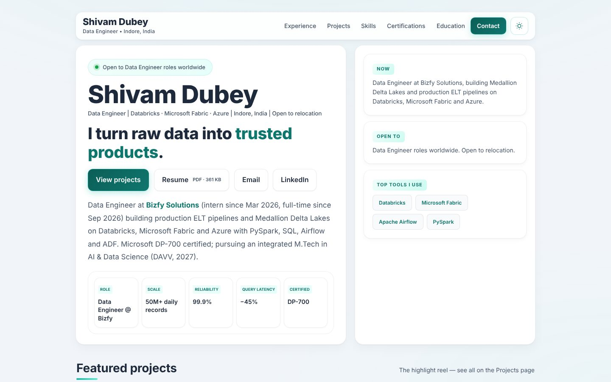
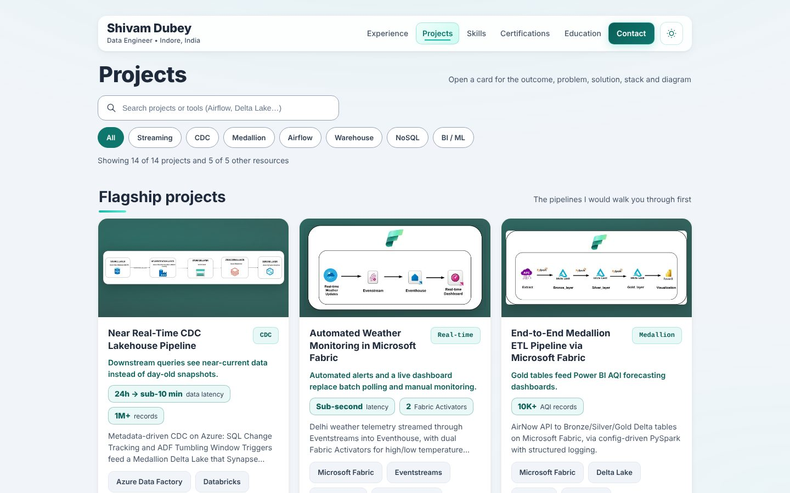

# Shivam Dubey — Portfolio

Static portfolio (plain HTML / CSS / JS, no build step, hosted on GitHub Pages) for **Shivam Dubey**, a working **Data Engineer** at Bizfy Solutions (intern since Mar 2026, full-time since Sep 2026), based in Indore, India and open to Data Engineer roles worldwide.

**Live site:** https://shivamdubey2310.github.io/portfolio/ <!-- TODO(confirm): live URL. This is the GitHub Pages default for this repo; update it (and robots.txt, sitemap.xml, canonical/OG tags) if you use a custom domain. -->




## What's on the site

**`index.html`**
- Hero: name, one-line identity, "open to roles" badge, Resume / Email / LinkedIn buttons and key stats (50M+ daily records, 99.9% reliability, −45% query latency, DP-700)
- Featured projects (each links to its case study on the projects page)
- **Experience**: Data Engineer (Sep 2026 – present) and Data Engineer Intern (Mar – Aug 2026), newest first
- Skills, Certifications (dated, with Verify links), Education, Leadership, Contact (copy-email button, optional form)
- A hidden **Writing** scaffold, ready for the first post

**`projects.html`**: 5 flagship projects up front, 9 more under a collapsed "More projects" group, plus 5 practice/reference resources. Search and topic chips (Streaming, CDC, Medallion, Airflow, Warehouse, NoSQL, BI / ML) combine. Click a card for the detail view (outcome → problem → solution → stack), a zoomable diagram, and Previous / Next. `projects.html#<slug>` deep-links to a project.

`404.html`, `robots.txt`, `sitemap.xml`, `site.webmanifest`, favicons and an Open Graph image are included.

## How it's built

| Path | What it is |
|---|---|
| `index.html`, `projects.html`, `404.html` | The pages (hand-written HTML) |
| `assets/styles.css` | All styling, light + dark themes (`body.dark-mode`). Phase-B refinements are at the end of the file |
| `assets/app.js` | Theme toggle, mobile menu, active-section nav, back-to-top, reveal-on-scroll, copy-email, contact form |
| `assets/projects.js` | `.txt` parser, detail dialog, filters, lightbox, deep links |
| `Project_data/`, `Other_project_data/` | One `.txt` per project card (the detail view content) |
| `project_images/`, `Other_project_images/` | Diagram PNGs (fallback) and `web/*.webp` (served to modern browsers) |
| `tools/` | `og-card.html` (Open Graph template) and `make-webp.py` (image helper) |

Principles: content stays visible with JS off (animations only start once `app.js` runs); motion is off for `prefers-reduced-motion` and touch devices; no frameworks, no trackers (an analytics snippet is included but commented out).

## Add or edit a project

1. **Diagram:** save a PNG as `project_images/<Project name>.png`, then run
   ```bash
   python3 tools/make-webp.py "project_images/<Project name>.png"
   ```
   It writes `web/<slug>-640.webp` and `web/<slug>-full.webp` and prints the sizes to use below.
2. **Detail text:** create `Project_data/<Project name>.txt` (format below).
3. **Card:** copy an existing `<article class="projectCard" …>` in `projects.html` into the flagship grid or the "More projects" group and update: `data-project` (exact `.txt`/`.png` name), `data-slug`, `data-github`, `data-tags` (any of `streaming cdc medallion airflow warehouse nosql bi-ml`), `data-search`, `data-full-w` / `data-full-h`, the image `src` (URL-encoded), `width` / `height`, meaningful `alt` text describing the diagram, and the title / summary / tags.
4. Optional per-card attributes: `data-demo="https://…"` shows a **Live demo** button in the detail view (nothing renders without it).

### `.txt` format

Every section is optional. The first line is the title (skipped). Lines starting with `#` are comments.

```text
My Project Name

Results
One-line outcome sentence.            <- first plain line = outcome
- 24h → sub-10 min | Data latency     <- "- value | label" = metric chip
- 1M+ | Records processed

My Role
One line: what I owned.

Project Info
- Year: 2026
- Status: Completed

Overview
Short summary.

The Challenge
The problem (plain lines or "- bullets").

The Solution
Intro sentence.
- Label: what was built               <- "Label:" is bolded; indent a bullet to nest it
- Another: …

Tech Stack
- Platform: Microsoft Fabric

Key Highlights
- Label: highlight
```

Detail order is Results → My Role → Overview → Challenge → Solution → Tech Stack → Highlights → Links. **Only put numbers in `Results` that the resume supports.** Each existing `.txt` ends with a commented-out `My Role` / `Project Info` stub to fill in.

## Content rules

- Facts come from the resume (`ShivamDubey.pdf`); `details.md` mirrors them. No invented metrics.
- Employer clients, internal systems and data sources are never named.
- No phone number on the site.
- `ShivamDubey.pdf` is linked as-is (with its size, 321 KB, shown next to the button; update the label if the PDF changes).
- Canonical LinkedIn: https://www.linkedin.com/in/shivam-dubey20
- The "Last updated" date in the footer and `sitemap.xml` is static; bump it when you publish content changes.

## Open items (`TODO(confirm)`)

Search the repo for `TODO(confirm)`. Currently:
- Live site URL (canonical, Open Graph, sitemap, robots, 404 asset paths)
- LeetCode and HackerRank profile URLs, and the wording of "5+ HackerRank badges" (Skills → Problem Solving)
- Whether the hero needs a "Learning" card, and what it says
- Per-project **role, year, status** (stubs at the end of each `Project_data/*.txt`) and any **live demo** URLs
- GitHub URL for the Near Real-Time CDC Lakehouse project (not in `project_links.txt`)
- Typical reply time for the Contact section
- Contact form endpoint (Formspree / Web3Forms); the form stays hidden until `data-endpoint` is set
- GoatCounter site code (analytics snippet is commented out)
- Official certification badge images (the current badges are generic monogram icons)

## Run locally

```bash
python3 -m http.server 8000
```

Then open http://localhost:8000. (The detail view fetches `.txt` files, so opening the HTML file directly from disk won't work.)

## Regenerate the Open Graph image

`tools/og-card.html` is a 1200×630 template. Render it with any headless browser at that viewport and save the screenshot as `assets/og-image.png`. Keep the numbers in sync with the resume.
